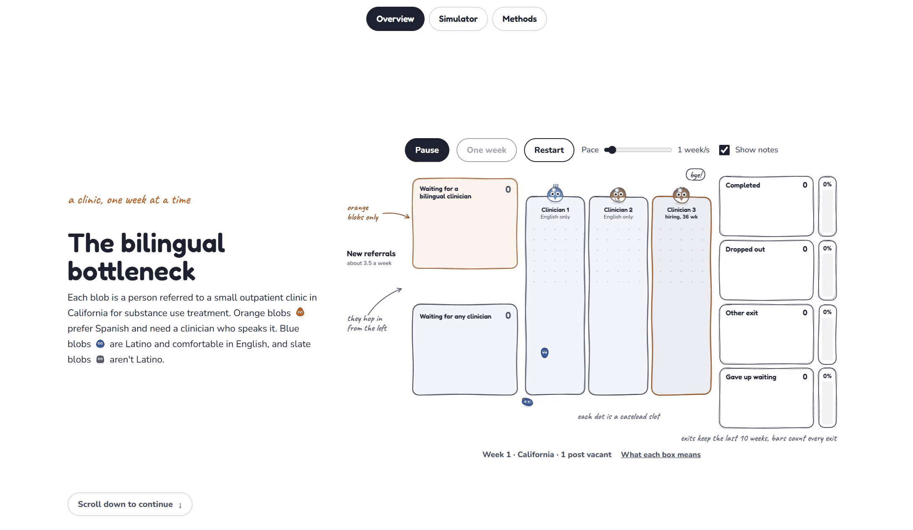

# Language access in California outpatient treatment: a stochastic clinic model

Prepared for Dr. Miriam Nuño (UC Davis, Center for Reducing Health Disparities).



## Question

A Spanish-preferring patient referred to a small outpatient clinic in California has to wait for a clinician who speaks Spanish. The question is how often that wait costs the clinic the patient, and how many bilingual clinicians a clinic needs in communities with different Latino populations.

## Findings

1. **Inside treatment, Latino and non-Latino patients in California do about the same.** In 65,407 California outpatient episodes from TEDS-D 2024, 27.3% of Hispanic episodes ended in completion against 24.6% of non-Hispanic episodes. After adjusting for age, sex, primary substance, referral source, prior treatment, co-occurring mental illness and service intensity, the odds ratio for completion is 0.96 (95% CI 0.93 to 1.00) and for dropout 1.01 (0.98 to 1.05). Dropout runs near 48% for both groups, which makes it the largest problem in the data.
2. **The fitted chains still differ in timing.** A likelihood-ratio test rejects a single chain for both groups (LR = 372, df = 27, p < 10⁻⁶⁰). Hispanic episodes last 20.7 weeks on average (95% CI 20.4 to 21.1), non-Hispanic episodes 23.0 weeks (22.6 to 23.4).
3. **Hispanic patients already wait more before admission.** 25.9% of Hispanic episodes with a recorded wait started after one or more days, against 18.8% of non-Hispanic episodes. Each week of waiting raises the odds of dropping out by 3.0% (OR 1.030, 95% CI 1.005 to 1.057, n = 64,077).
4. **One bilingual clinician covers most California communities, until that clinician leaves.** In a three-clinician clinic with one bilingual post, Spanish-preferring referrals give up waiting about as often as non-Latino referrals in Sacramento, Los Angeles and Salinas (7% to 9%). In a community like El Centro (86% Latino), 15% of Spanish-preferring referrals give up, twice the non-Latino rate of 7%. A second bilingual clinician brings that back to 9% (Fig. 3).
5. **Staff turnover drives most of the giving up.** In the sensitivity analysis, the time to refill a post (PRCC 0.60), the extra time to refill a bilingual post (0.62), annual turnover (0.49) and demand relative to capacity (0.47) explain the share of Spanish-preferring referrals who give up. Once a clinic has one bilingual clinician, the Latino share and the Spanish-preferring share move the result little (PRCC under 0.1). A clinic with a single bilingual post has a single point of failure (Fig. 4).
6. **Holding bilingual slots for Spanish speakers has a price.** In the San Benito profile, reserving idle bilingual slots cut the Spanish-preferring wait from 0.25 to 0.08 weeks and raised their completion from 24.0% to 25.6%, but total completions fell from 50.3 to 47.1 per year because English-speaking referrals waited longer.

The placeholder version of this model, built before loading the data, predicted a 20-point gap, driven by Spanish-preferring patients giving up on a long waitlist. With treatment lengths fitted to TEDS-D and staffing taken from published sources, that waitlist forms when the bilingual post sits empty or, in places like El Centro, when Spanish-speaking demand fills the bilingual caseload. The disparity that remains sits upstream, in who gets a first appointment.

## Per-metro settings

`communities.py` builds a profile for California and for each metro (CBSA) with 500+ outpatient episodes. Each profile has its own Latino share and its own treatment chain per group, refitted by maximum likelihood with the statewide number of phases. A group with fewer than 400 episodes keeps the statewide chain. The script then sets each area's referral volume by calibration: it searches for the load at which the simulated three-clinician clinic makes the same share of admitted patients wait a week or more as TEDS-D reports for 8+ days in that area.

| Area | Episodes | Latino | Waited 8+ days | Completed (Latino / non-Latino) | Chains | Calibrated load | Referrals/week |
|---|---|---|---|---|---|---|---|
| California | 65,407 | 48% | 5.4% | 27% / 25% | statewide | 0.84 | 3.5 |
| Los Angeles | 20,438 | 56% | 4.7% | 30% / 30% | own fit | 0.82 | 3.7 |
| Riverside-San Bernardino | 10,102 | 52% | 7.0% | 26% / 25% | own fit | 0.89 | 4.2 |
| San Diego | 9,255 | 43% | 3.4% | 32% / 29% | own fit | 0.78 | 4.1 |
| Sacramento | 790 | 27% | 1.4% | 10% / 10% | statewide (Latino) / own fit | 0.68 | 1.5 |
| San Francisco-Oakland | 2,841 | 30% | 6.8% | 25% / 13% | own fit | 0.86 | 3.0 |
| San Jose | 1,350 | 70% | 11.5% | 43% / 34% | own fit | 0.93 | 4.6 |
| Fresno | 1,026 | 48% | 0.8% | 9% / 2% | own fit | 0.73 | 0.6 |
| Bakersfield | 2,492 | 48% | 10.1% | 17% / 20% | own fit | 0.92 | 4.7 |
| Salinas | 786 | 65% | 8.0% | 21% / 18% | own fit (Latino) / statewide | 0.89 | 3.7 |
| Visalia | 1,610 | 61% | 17.5% | 23% / 25% | own fit | 1.01 | 3.7 |
| Oxnard | 1,305 | 57% | 1.0% | 18% / 16% | own fit | 0.59 | 2.0 |
| Modesto | 1,863 | 37% | 2.6% | 33% / 30% | own fit | 0.72 | 2.8 |
| Merced | 575 | 60% | 5.0% | 26% / 19% | statewide | 0.82 | 3.4 |
| El Centro | 609 | 86% | 4.2% | 17% / 27% | own fit (Latino) / statewide | 0.82 | 2.6 |

Calibrated load is referrals relative to the 90 slots of a standard clinic, and referrals per week follow from Little's law with each area's own treatment lengths. Fresno and Sacramento report few episodes and very low completion, which points to local reporting practices, so read those two with care. The Spanish-preferring share stays at the statewide 27% everywhere, since no source with a county breakdown of English proficiency among Latinos turned up. The animation adds a San Benito County profile from that county's own plan.

## Model structure

| Layer | Method | Implementation |
|---|---|---|
| Referrals | Poisson processes | Three Poisson streams (Spanish-preferring Latino, English-proficient Latino, non-Latino). Little's law sets the total rate: λ = load × slots ÷ mean weeks in treatment. Clinician departures form a fourth Poisson process. |
| Waiting | Queueing | Two server pools (bilingual and English-only caseload slots, 30 per clinician), FIFO, with reneging. Spare bilingual slots go to English speakers only when no Spanish-preferring patient waits. |
| Treatment | Markov chains | Weekly absorbing chain with K latent phases and three absorbing states (completed, dropped out, other exit). Outputs: N = (I − Q)⁻¹, B = NR and t = N1. The simulated exit shares come within one percentage point of B. |
| Decisions | Stochastic optimization | Staffing mixes across six community profiles, 200 replications each with common random numbers, and a slot-reservation policy. |

## Fitting the chain to TEDS-D

`estimate_from_tedsd.py` keeps California (STFIPS 6) intensive and non-intensive outpatient discharges (SERVICES_D 6 and 7). TEDS-D reports length of stay in days up to 30 and in bands after that, so the script computes, for any chain, the probability of each exit type inside each reported interval and maximizes the multinomial likelihood of the 37 × 3 table.

- **Number of phases.** BIC picks K = 5 for Hispanic episodes and K = 7 for non-Hispanic episodes (search over K = 3 to 7). Absorption probabilities and mean weeks change by less than a week across K = 5, 6 and 7.
- **Uncertainty.** 200 bootstrap resamples of each table give the intervals above.
- **Fit.** Fig. 1 compares observed and fitted length-of-stay distributions by exit type. The fitted phases describe the shape of the length-of-stay distribution and carry no clinical meaning.
- **Wait effect.** A logistic regression of dropout on weeks waited (DAYWAIT band midpoints), adjusted for ethnicity and co-occurring mental illness, gives the episode-level odds ratio. `settings.py` converts it to an effect on weekly dropout odds during the first four weeks in care (0.091 per week waited) by solving for the value that reproduces the episode-level ratio.
- **Recovery check.** `check_estimator.py` generates fake TEDS-D files from a known chain and refits them. Across three fake datasets, estimates land within one percentage point of the true absorption probabilities and 0.1 weeks of the true mean, and 22 of 24 true values fall inside the 95% bootstrap intervals, close to the 23 you'd expect (`outputs/estimator_recovery_check.txt`).

`describe_tedsd.py` produces the descriptive tables and the adjusted odds ratios in `outputs/tedsd_ca_summary.json`.

## Settings and sources

TEDS-D supplies the chains, the wait effect and the Latino share. The rest come from published sources, and `sensitivity.py` moves each across its range.

| Setting | Base | Range | Source |
|---|---|---|---|
| Latino share of referrals | 47.6% | 27% to 65% | TEDS-D 2024 CA outpatient. Across 18 CA metros with 500+ episodes the share runs from 7% to 86%, and the range spans Sacramento (26.7%) to Salinas (64.8%). |
| Spanish-preferring share of Latinos | 27% | 15% to 39% | ACS 2021 via CHCF Latino Health Almanac: 27% of CA Latinos speak English less than very well, 15% not well or not at all. High end: San Benito County Behavioral Health, 64% Latino clients and about 1 in 4 clients preferring Spanish. |
| Caseload per clinician | 30 | 20 to 40 | Survey of SUD counselors, mean 30 (range 6 to 42), and the New Jersey outpatient standard 1:35. |
| Clinicians | 3 | fixed | N-SUMHSS 2023: 70,614 outpatient clients in 933 CA outpatient facilities, about 76 per facility. |
| Demand vs capacity | 0.95 | 0.80 to 1.10 | Assumption, tested across the range. |
| Weekly probability of giving up | 0.21 | 0.10 to 0.30 | Kaplan and Johri (2000): waitlist tolerance about one month, about 40% leave within two weeks. |
| Wait effect on early dropout | 0.091 | 0 to 0.35 | TEDS-D logistic fit. The high end matches NIATx (Hoffman et al. 2011), where session-4 attendance fell from 68.2% to 40.8% after a 30-day wait. |
| Annual clinician turnover | 33.2% | 19% to 50% | Eby, Burk and Maher (2010), 27 SUD treatment organizations. |
| Weeks to refill a post | 8.7 | 4.3 to 13 | Santa Cruz County Civil Grand Jury (2023): county hiring takes one to three months. |
| Extra time for a bilingual post | 1.5× | 1× to 3× | Assumption, no published figure found. |

## Running it

```
python estimate_from_tedsd.py tedsd_puf_2024.csv --stages 3,4,5,6,7 --boot 200 --out outputs/params_tedsd_ca.json
python describe_tedsd.py tedsd_puf_2024.csv
python sim.py --reps 200
python sensitivity.py --reps 100 --lhs 300 --lhs-reps 20
python figures.py
python communities.py tedsd_puf_2024.csv
python export_animation_params.py
```

The TEDS-D file is about 230 MB unzipped and is not included within the repo. You can download it from SAMHSA (TEDS-D 2024, Delimited). Python 3 with numpy, scipy, pandas and matplotlib runs every script. The fit takes about 15 minutes, the simulation 3, the sensitivity analysis 5.

`animation/` holds the explorable page: a scrolling story with the clinic pinned on screen, a full model with every setting beside the board, and a theory section with the math, the fitted matrices and the figures. Open it through a local server (`python -m http.server` inside `animation/`), since the page loads `params.json` and the figures.

## Limits

- TEDS-D records ethnicity, not language. Spanish-preferring patients use the Hispanic chain, so the model can't show any in-treatment effect of language-concordant care.
- TEDS-D records people who reached treatment. People who gave up before admission leave no record, so the access side of the model rests on published waitlist studies.
- When a clinician quits, their patients continue in care as if colleagues covered them, and the room only stops taking new patients. A real departure may push some patients to transfer or drop out, but no published estimate turned up.
- The model has no interpreters. With zero bilingual clinicians, Spanish-preferring referrals wait until they give up, a boundary case left out of the figures.
- TEDS-D counts episodes at publicly funded facilities that report to the state. One person can appear more than once.
- Co-occurring mental illness is recorded for 10.9% of California outpatient episodes, low enough that the mental-health subgroup (`--co-occurring`) has wide intervals.

## Files

| File | Contents |
|---|---|
| `estimate_from_tedsd.py` | Maximum-likelihood fit of the chain, BIC, bootstrap, LR test, wait-effect regression |
| `check_estimator.py` | Parameter recovery on fake data |
| `describe_tedsd.py` | Descriptive tables and adjusted odds ratios |
| `settings.py` | Every setting with its source and range |
| `sim.py` | Clinic simulation and experiments |
| `sensitivity.py` | One-way and Latin hypercube sensitivity with PRCC |
| `figures.py` | Figures 1 to 5 |
| `communities.py` | Per-metro chains and calibrated referral volume |
| `export_animation_params.py` | Writes the settings the animation loads |
| `outputs/` | Fitted parameters, results, logs, figures |
| `animation/` | Animated clinic page |

## Sources

- SAMHSA. Treatment Episode Data Set: Discharges (TEDS-D) 2024 public use file, and the TEDS-D 2023 codebook.
- SAMHSA. N-SUMHSS 2023 Substance Use Treatment Services State Profile: California.
- California Health Care Foundation. California Latino Health Almanac, 2025.
- Kaplan EH, Johri M. Treatment on demand: an operational model. Health Care Manag Sci, 2000. Figures as reported in a study of people placed on drug treatment waiting lists, PMC2766557.
- Hoffman KA et al. Days to treatment and early retention among patients in treatment for alcohol and drug disorders. Addict Behav, 2011 (PMC3070832).
- Eby LT, Burk H, Maher CP. How serious of a problem is staff turnover in substance abuse treatment? J Subst Abuse Treat, 2010.
- Santa Cruz County Civil Grand Jury. Behavioral health staffing report, 2023 (via Santa Cruz Local).
- San Benito County Behavioral Health. Cultural competence plan.
- New Jersey Administrative Code 10:161B-10.1 (outpatient counselor ratios).
- Outpatient SUD counselor survey, Addiction Science & Clinical Practice, 2021 (s13722-021-00247-5), caseload table.
